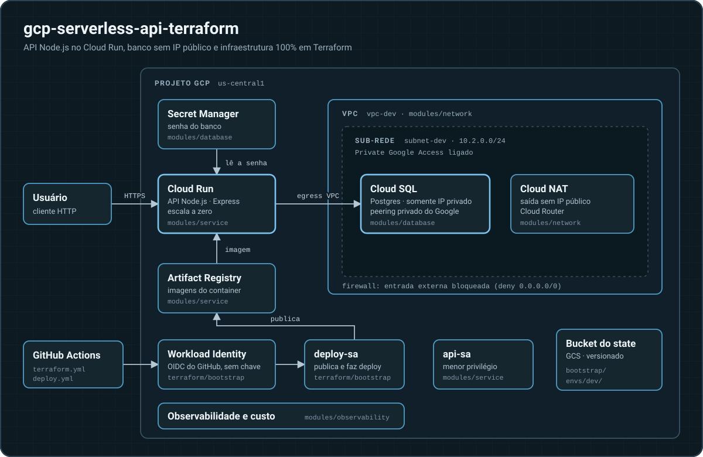

# gcp-serverless-api-terraform


Uma API Node.js rodando no **Google Cloud Run**, com banco **Cloud SQL sem IP público**, segredos no **Secret Manager** e toda a infraestrutura descrita em **Terraform**, com state remoto e um diretório raiz por ambiente.

Este projeto existe para mostrar, na prática, boas práticas de infraestrutura na nuvem: código versionado, ambientes isolados, menor privilégio, nenhum segredo no repositório e um ciclo de `apply` e `destroy` que funciona do zero.

> **Status:** a infraestrutura de rede, banco e Cloud Run está pronta, aplicada e testada no GCP, e a API de `app/` roda no Cloud Run, conectada ao banco privado. O deploy é automático: um push na `main` dispara um pipeline do GitHub Actions que autentica por Workload Identity Federation (sem chave de service account), publica a imagem, roda as migrations e faz o deploy. A observabilidade também está pronta: um uptime check, alertas de queda e de erros 5xx e um orçamento de custos avisam por e-mail. O ambiente de produção (`envs/prod`) reaproveita os mesmos módulos num projeto GCP separado e é implantado por um workflow manual (veja o [roadmap](#roadmap)).

---

## Arquitetura



O usuário só conversa com o Cloud Run. O banco fica dentro da VPC, sem IP público, e o Cloud Run entra na VPC por *Direct VPC egress*, enviando para ela apenas o tráfego destinado a IPs privados.

## Stack

| Camada | Tecnologia |
|---|---|
| Infraestrutura como código | Terraform `~> 1.17`, provider `google ~> 8.10` |
| Computação | Cloud Run (v2), escala a zero |
| Banco | Cloud SQL Postgres, IP privado via Private Service Access |
| Segredos | Secret Manager: senha e URL do banco e segredos do JWT, todos gerados pelo Terraform (`random_password`) |
| Migrations | Cloud Run Job (`prisma migrate deploy`) dentro da VPC |
| CI/CD | GitHub Actions + Workload Identity Federation (sem chave de service account) |
| Observabilidade | Cloud Monitoring: uptime check, alertas de queda e de 5xx por e-mail, e orçamento de custos |
| Imagens | Artifact Registry, tags imutáveis |
| Rede | VPC customizada, sub-rede com Private Google Access, Cloud Router + NAT |
| State | Bucket GCS com versionamento e acesso público bloqueado |
| API | Node.js, Express 5, Prisma 7, Zod, JWT |
| Testes | Vitest + Supertest |

## Decisões de arquitetura

Cada escolha tem uma alternativa descartada e um motivo. Esse é o resumo; os registros completos estão em [`docs/adr/`](docs/adr/README.md).

| # | Decisão | Alternativa descartada | Por quê |
|---|---|---|---|
| 1 | Cloud Run para a API | MIG com load balancer, GKE | API stateless: escala a zero, custo mínimo, nenhuma VM para gerenciar |
| 2 | Cloud SQL só com IP privado, acessado por Direct VPC egress | IP público com redes autorizadas | O banco não fica exposto à internet |
| 3 | Uma service account por workload (`api-sa`) | SA padrão do Compute | Menor privilégio: a SA padrão costuma ter papel Editor |
| 4 | Senha do banco no Secret Manager | Variável de ambiente no código | Segredo versionado, auditável e fora do repositório |
| 5 | State em bucket GCS versionado | State local ou no Git | Locking, histórico e nenhum segredo no Git |
| 6 | Um diretório raiz por ambiente (`envs/dev` e `envs/prod`) | Um diretório só com arquivos de variáveis | State isolado: um `apply` no dev nunca toca o prod |
| 7 | Módulo `bootstrap` separado | Criar o bucket do state à mão | Resolve o ovo e a galinha de forma reproduzível |
| 8 | Migrations por Cloud Run Job dentro da VPC | Rodar do CI ou do notebook | O banco é privado: só quem está na VPC o alcança; o pipeline apenas dispara o job |
| 9 | Direct VPC egress | Serverless VPC Access connector | Sem recurso extra nem custo fixo do conector |
| 10 | Imagem trocada fora do Terraform (`ignore_changes`) | Terraform controlando a imagem | A infra e o deploy da aplicação têm ciclos diferentes; o pipeline troca a imagem |
| 11 | CI/CD com Workload Identity Federation | Chave JSON de service account guardada no GitHub | Sem credencial de longa duração para vazar: o GitHub apresenta um token temporário e o GCP só o aceita para este repositório |
| 12 | Pool e provider do WIF no `bootstrap` | Pool dentro do ambiente `dev` | O `destroy` do dev não apaga o pool, e um pool apagado fica com o ID reservado por cerca de 30 dias |
| 13 | Alertas de uptime (mais de 1 local falhando) e de 5xx (qualquer erro), por e-mail | Limites altos, ou alertar com 1 local | Um 5xx é falha do servidor e um e-mail à toa custa pouco; já o uptime exige 2 locais para não alarmar por falha de rede de um só |
| 14 | Orçamento no `bootstrap`, com canal de e-mail próprio | Orçamento dentro do `dev` ou só no console | O `destroy` do dev não apaga o alerta de custo, e tudo fica no código |
| 15 | Produção em projeto GCP separado, state no mesmo bucket com outro prefixo | Mesmo projeto com sufixo nos nomes | Os módulos têm nomes fixos; em projetos diferentes eles não colidem e os módulos ficam intactos |
| 16 | Deploy do prod por workflow manual com GitHub Environment (`prod`) | Um único conjunto de variáveis no repositório | Variáveis próprias do prod, restrição ao `main` e deploy só por clique |

## Estrutura do repositório

```
.
├── .github/workflows/           # deploy.yml (dev, a cada push) e deploy-prod.yml (prod, manual)
├── app/                         # API Express + Prisma + testes
├── docs/
│   ├── adr/                     # registros de decisão de arquitetura
│   └── arquitetura.svg
├── terraform/
│   ├── bootstrap/               # bucket do state, pool/provider do WIF e orçamento de custos (roda uma vez)
│   ├── modules/
│   │   ├── network/             # VPC, sub-rede, firewall, Cloud Router e NAT
│   │   ├── database/            # Cloud SQL, usuário, banco, senha e URL de conexão
│   │   ├── service/             # Cloud Run, Job de migrations, api-sa, segredos do JWT, Artifact Registry
│   │   ├── cicd/                # deploy-sa e permissões do pipeline
│   │   └── observability/       # canal de e-mail, uptime check, alertas de queda e de 5xx
│   └── envs/
│       ├── dev/                 # chama os módulos, state próprio
│       └── prod/                # os mesmos módulos, outro projeto GCP e state próprio
└── README.md
```

Cada pasta que roda `apply` (`bootstrap` e `envs/*`) tem o seu próprio `versions.tf`, lock file e *prefix* de state no mesmo bucket.

## Segurança

- **Sem chave de service account.** Localmente a autenticação usa Application Default Credentials; no CI, Workload Identity Federation. O provider só aceita tokens do repositório e do dono configurados, e o pipeline assume a `deploy-sa`, que só pode enviar imagens ao registry, atualizar o Cloud Run e o Job, e agir como a `api-sa`.
- **Banco sem IP público** (`ipv4_enabled = false`), acessível só de dentro da VPC.
- **Menor privilégio.** A `api-sa` recebe apenas `roles/cloudsql.client` e leitura de três segredos (URL do banco e os dois do JWT), um a um, e o Cloud Run roda com ela, não com a conta padrão.
- **Nenhum segredo no Git.** `*.tfvars`, `*.tfstate` e planos salvos estão no `.gitignore`; a senha do banco e os segredos do JWT são gerados pelo Terraform e vão direto para o Secret Manager.
- **Bucket do state protegido:** acesso público bloqueado, versionamento ligado, `prevent_destroy` e regra de limpeza de versões antigas.
- **Registry com tags imutáveis**, para que uma tag nunca aponte para duas imagens diferentes.
- **API:** autenticação JWT com refresh token rotativo, cookies `httpOnly`, e escrita no catálogo de produtos restrita ao papel `ADMIN`, com testes de controle de acesso.

### Limitações conhecidas

- O Cloud Run está aberto à internet (`allUsers` como invoker) porque é uma API pública. A autenticação fica por conta da própria API.
- A senha gerada pelo Terraform fica no state em texto. Por isso o bucket é privado e versionado.
- O provider do WIF aceita qualquer branch do repositório, não só a `main`. Restringir (`assertion.ref`) ou usar Environments com aprovação é uma melhoria planejada.
- O Terraform ainda é aplicado à mão; o pipeline cobre só o deploy da aplicação.
- O acesso humano ao banco (consultas) ainda não existe: o banco só tem IP privado. Um bastion com túnel IAP é uma melhoria planejada.
- O alerta de 5xx só foi validado pelo `apply`; o de uptime foi testado derrubando o acesso público. Já o `/health` não consulta o banco, então uma queda do banco só aparece como 5xx nas rotas que dependem dele.
- O orçamento só avisa, não bloqueia o gasto, e não tem aviso de 100% do gasto real.
- O Environment `prod` só aceita o `main`, mas **não exige aprovação de revisor**: a tela do GitHub não ofereceu essa regra neste repositório privado (provavelmente limite do plano; não confirmei). Quem tem acesso de escrita pode disparar o deploy do prod.
- O módulo `observability` tem o nome do canal fixo ("Alertas API dev"), que aparece também no prod.
- Dev e prod dividem o mesmo bucket de state e o mesmo pool de WIF.

## Como rodar

### Pré-requisitos
- Conta GCP com um projeto e faturamento ativo
- [Terraform](https://developer.hashicorp.com/terraform/install) `>= 1.17` e [gcloud CLI](https://cloud.google.com/sdk/docs/install)

```bash
gcloud auth application-default login
```

### 1. Bootstrap (uma vez)
Cria o bucket que guarda o state dos outros ambientes, o pool/provider do Workload Identity Federation e o orçamento de custos, que vivem fora do `destroy` do dev. Em `terraform/bootstrap/`, crie um `terraform.tfvars`:

```hcl
project_id                 = "SEU-PROJETO"
bucket_name                = "NOME-UNICO-DO-BUCKET"
github_repository          = "SEU-USUARIO/SEU-REPOSITORIO"
github_repository_owner_id = "ID-NUMERICO-DA-SUA-CONTA"   # https://api.github.com/users/SEU-USUARIO
billing_account            = "XXXXXX-XXXXXX-XXXXXX"       # console, Billing
alert_email                = "voce@exemplo.com"
```

O provider usa o seu projeto como cota (`user_project_override`), então, **na primeira vez**, ligue à mão as duas APIs que o próprio Terraform precisa para gerenciar APIs:

```bash
gcloud services enable cloudresourcemanager.googleapis.com serviceusage.googleapis.com --project=SEU-PROJETO
```

O orçamento (`google_billing_budget`) usa a moeda da conta de billing: ajuste `currency_code` e `units` em `bootstrap/main.tf` se a sua não for BRL.

```bash
cd terraform/bootstrap
terraform init
terraform apply
```

Ajuste o `bucket` no `backend.hcl` e, se quiser guardar também o state do bootstrap no bucket:

```bash
terraform init -migrate-state -backend-config=backend.hcl
```

### 2. Ambiente dev
Em `terraform/envs/dev/`, crie o `terraform.tfvars` com `project_id = "SEU-PROJETO"` e `alert_email = "voce@exemplo.com"` (e as demais variáveis do `variables.tf`) e ajuste o `backend.hcl` para o seu bucket. O ambiente lê o nome do pool do state do bootstrap (`terraform_remote_state`), por isso o bootstrap precisa ter sido aplicado antes; ajuste também o `bucket` e o `github_repository` em `envs/dev/main.tf`.

```bash
cd terraform/envs/dev
terraform init -backend-config=backend.hcl
terraform plan -out=tfplan
terraform apply tfplan
```

Ao final, a URL pública aparece nos outputs:

```bash
terraform output api_final_url
```

### 3. Deploy da API
O Terraform cria a infraestrutura com a imagem de exemplo `hello`; a imagem real é enviada à parte. Cada commit gera uma tag nova, porque o registry tem tags imutáveis.

#### Pelo pipeline (padrão)
No repositório do GitHub, crie estas **Variables** (Settings, Secrets and variables, Actions; não são segredos). Os dois últimos valores saem de `terraform output`:

| Variable | Valor |
|---|---|
| `GCP_PROJECT_ID` | o ID do projeto |
| `GCP_REGION` | `us-central1` |
| `WIF_PROVIDER` | output `provider_name` |
| `DEPLOY_SA_EMAIL` | output `email_deploy_sa` |

Depois, um push na `main` que altere `app/` (ou **Actions, Deploy API, Run workflow**) faz: autenticar por WIF, build, push da imagem com o SHA do commit, migrations pelo Job e deploy. Se as migrations falham, o deploy não acontece. Depois de um `destroy`, o registry volta vazio: basta disparar o workflow de novo.

#### À mão (alternativa)
```bash
gcloud auth configure-docker us-central1-docker.pkg.dev

IMAGE=us-central1-docker.pkg.dev/SEU-PROJETO/api-dev-repository/sales-api:$(git rev-parse --short HEAD)
docker build -t $IMAGE app/
docker push $IMAGE
```

Como o banco só tem IP privado, as migrations rodam num Cloud Run Job dentro da VPC. Atualize a imagem do job, execute e só depois faça o deploy da API:

```bash
gcloud run jobs update migrate-database \
  --project SEU-PROJETO --region us-central1 --image $IMAGE

gcloud run jobs execute migrate-database \
  --project SEU-PROJETO --region us-central1 --wait

gcloud run deploy cloudrun-api \
  --project SEU-PROJETO --region us-central1 --image $IMAGE
```

> Não use `--no-allow-unauthenticated` no `gcloud run deploy`: o flag remove a permissão pública que o Terraform criou. Sempre passe `--project`, para não implantar no projeto ativo errado.

Teste:

```bash
curl $(terraform output -raw api_final_url)/health
```

### 4. Destruir
```bash
terraform destroy
```

> **Custo:** o Cloud SQL e o Cloud NAT cobram por hora enquanto existirem. O orçamento do `bootstrap` avisa por e-mail quando o gasto passa de 50% e quando a previsão passa de 90%, mas não bloqueia nada: destrua o ambiente ao fim de cada sessão.
>
> **Observação sobre o `destroy`:** o Google libera com atraso o endereço reservado pelo Direct VPC egress e a conexão privada do Cloud SQL. Se o `destroy` falhar com "resource in use", espere um pouco e rode de novo. O nome de uma instância do Cloud SQL apagada também pode ficar reservado por cerca de uma semana.

### Ambiente prod
O `prod` usa os mesmos módulos em **outro projeto GCP** (crie o projeto e ligue o faturamento antes). Em `terraform/envs/prod/`, o `backend.hcl` aponta para o mesmo bucket com `prefix = "envs/prod"`, e o `terraform.tfvars` tem o `project_id` do projeto novo:

```bash
cd terraform/envs/prod
terraform init -backend-config=backend.hcl
terraform plan -out=tfplan
terraform apply tfplan
```

O deploy da API usa o workflow **Deploy API (prod)**, que só roda por clique (**Actions, Run workflow**, no `main`) e lê as variáveis do **GitHub Environment `prod`** (Settings, Environments): `GCP_PROJECT_ID`, `GCP_REGION`, `WIF_PROVIDER` e `DEPLOY_SA_EMAIL`, com os valores do projeto novo (os dois últimos saem do `terraform output` do prod). O Environment também limita o uso ao branch `main`. Depois, destrua o ambiente: o custo por hora vale para os dois.

### A API localmente
Crie `.env` e `.env.test` em `app/` com `DATABASE_URL`, `AUTH_SECRET`, `AUTH_SECRET_EXPIRES_IN`, `AUTH_REFRESH_SECRET` e `AUTH_REFRESH_SECRET_EXPIRES_IN` (o `.env.test` aponta para o banco de teste do `docker-compose.yml`).

```bash
cd app
docker compose up -d
npm install
npx prisma migrate deploy
npm test
```

## A API (`app/`)

API de vendas com autenticação e controle de acesso por papel:

- `/auth`: registro, login, logout, refresh de token e `me`
- `/user`, `/product`, `/order`: CRUD completo, com validação de entrada (Zod), checagem de dono do recurso e papel `ADMIN`
- Camadas separadas (rotas, middlewares, controllers, services), classes de erro e `errorHandler` central

## Roadmap

| Fase | Entrega | Status |
|---|---|---|
| 1 | Planejamento, diagrama e ADRs | Feito (ADRs seguem crescendo com cada fase) |
| 2 | Bootstrap, state remoto e módulo de rede | Feito |
| 3 | Cloud Run e Artifact Registry | Feito: API real no ar |
| 4 | Cloud SQL privado, segredos e migrations por Job | Feito: API conectada ao banco privado |
| 5 | CI/CD com GitHub Actions e Workload Identity Federation (deploy sem chave) | Feito: push na `main` faz build, migrations e deploy |
| 6 | Observabilidade: uptime check, alertas de queda e de erro 5xx, e orçamento | Feito: avisos por e-mail (os logs do Cloud Run já vão para o Cloud Logging por padrão) |
| 7 | Ambiente de produção reaproveitando os módulos | Feito: projeto GCP separado, 46 recursos criados e deploy pelo pipeline (`/health` ok) |

## O que este projeto me ensinou

- **O prefix do state isola ambientes.** Dois ambientes no mesmo prefix leem o mesmo state; um deles enxergaria os recursos do outro como "sobrando" e tentaria apagá-los.
- **Dependência por referência, não por texto.** Passar `module.network.network_id` entre módulos faz o Terraform montar o grafo; uma string solta não cria dependência nenhuma. Quando não há referência natural, como entre uma API habilitada e um módulo, entra o `depends_on`.
- **O `destroy` também tem ordem.** O Cloud SQL, a conexão privada e o Direct VPC egress seguram a VPC por um tempo depois de apagados.
- **Código gerado a partir de exemplos precisa ser relido.** Argumentos de outro banco ou de outro recurso parecem funcionar e só falham no `plan` ou no `apply`.
- **`terraform validate` confere o formato, não os valores.** Um `secret_type` inválido e um nome de job com underscore passam no `validate` e só falham no `apply`, porque quem rejeita é a API do Google.
- **Mexer na infra por fora do Terraform cria drift.** O `--no-allow-unauthenticated` do `gcloud run deploy` removeu a permissão pública criada pelo Terraform, e a API passou a responder `403` até o próximo `apply` repor o binding.
- **States separados trocam valores por `output` + `terraform_remote_state`.** O pool do WIF vive no bootstrap e o ambiente dev lê o nome dele do state do bootstrap. O membro do binding exige o nome **completo** do pool (`projects/NÚMERO/locations/global/workloadIdentityPools/...`), não o ID curto `github-pool`.
- **No WIF, o provider decide quem entra e o binding decide o que quem entrou pode usar.** Sem a condição do repositório no provider, qualquer repositório do GitHub poderia tentar; sem o `workloadIdentityUser`, ninguém consegue assumir a service account.
- **Um check que passa não avisa ninguém.** O uptime check só registra o resultado; quem manda o e-mail é a alert policy, que lê a métrica do check e usa o canal de notificação. O alerta de uptime foi testado de verdade, derrubando o acesso público.
- **Alerta de métrica responde sempre a quatro perguntas:** qual métrica olhar (`filter`), como resumir num número (`aggregations`), qual número é ruim (`comparison` e `threshold_value`) e por quanto tempo (`duration`). Os limites são uma troca entre avisar cedo (mais e-mails à toa) e avisar tarde.
- **Credenciais de usuário (ADC) precisam de um projeto de cota para algumas APIs.** A API de budgets respondeu `403 SERVICE_DISABLED` num projeto que não era o meu; `user_project_override` resolveu, e em seguida o Terraform passou a exigir `cloudresourcemanager` e `serviceusage` ligadas no meu projeto.
- **A moeda do orçamento tem de ser a da conta de billing.** Com `USD` numa conta em BRL, o Google devolveu só `400 invalid argument`.
- **Projeto separado resolve nomes fixos sem mexer nos módulos.** Os módulos têm `api-sa`, `deploy-sa` e outros nomes escritos no código; em dois projetos eles não colidem, e o `apply` do `prod` criou 46 recursos sem alterar um módulo.
- **O pool do WIF pode ficar em outro projeto.** O vínculo da `deploy-sa` do `prod` com o pool do `bootstrap` foi aceito no `apply`, e o primeiro deploy do pipeline provou que a troca de token funciona entre projetos.
- **Variável de Environment vale mais que a do repositório, mas só para o job que declara `environment`.** O mesmo workflow serve a dois ambientes; uma linha (`environment: prod`) decide de onde vêm os valores e quem pode rodar.
- **O `destroy` pode travar mesmo sem o banco.** O peering do Cloud SQL continuou "em uso" com zero instâncias no projeto (`gcloud sql instances list` vazio); apagar o peering pelo `gcloud compute networks peerings delete` foi aceito, e só então o Terraform pôde seguir.
- **Confira o projeto ativo do `gcloud`.** Um deploy sem `--project` tentou criar um serviço novo em outro projeto; o erro de permissão enganava, e a pista estava na linha do projeto no próprio log.

---

Feito por **Marcelo Henrique** · [github.com/K1dou](https://github.com/K1dou)
