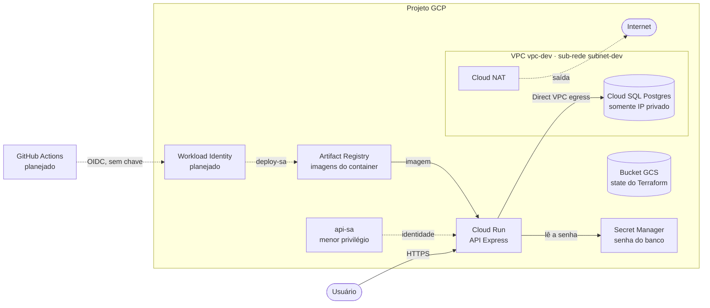

# gcp-serverless-api-terraform


Uma API Node.js rodando no **Google Cloud Run**, com banco **Cloud SQL sem IP público**, segredos no **Secret Manager** e toda a infraestrutura descrita em **Terraform**, com state remoto e um diretório raiz por ambiente.

Este projeto é onde eu pratico e demonstro boas práticas de infraestrutura na nuvem: código versionado, ambientes isolados, menor privilégio, nenhum segredo no repositório e um ciclo de `apply` e `destroy` que funciona do zero.

> **Status:** a infraestrutura de rede, banco e Cloud Run está pronta e foi aplicada e testada no GCP. O Cloud Run ainda roda a imagem de exemplo `hello` do Google; o deploy da API de `app/`, o CI/CD e a observabilidade são as próximas fases (veja o [roadmap](#roadmap)).

---

## Arquitetura



O usuário só conversa com o Cloud Run. O banco fica dentro da VPC, sem IP público, e o Cloud Run entra na VPC por *Direct VPC egress*, enviando para ela apenas o tráfego destinado a IPs privados.

## Stack

| Camada | Tecnologia |
|---|---|
| Infraestrutura como código | Terraform `~> 1.17`, provider `google ~> 8.10` |
| Computação | Cloud Run (v2), escala a zero |
| Banco | Cloud SQL Postgres, IP privado via Private Service Access |
| Segredos | Secret Manager, senha gerada pelo Terraform (`random_password`) |
| Imagens | Artifact Registry, tags imutáveis |
| Rede | VPC customizada, sub-rede com Private Google Access, Cloud Router + NAT |
| State | Bucket GCS com versionamento e acesso público bloqueado |
| API | Node.js, Express 5, Prisma 7, Zod, JWT |
| Testes | Vitest + Supertest |

## Decisões de arquitetura

Cada escolha tem uma alternativa descartada e um motivo. Esse é o resumo; os registros completos (ADRs) vão para `docs/adr/`.

| # | Decisão | Alternativa descartada | Por quê |
|---|---|---|---|
| 1 | Cloud Run para a API | MIG com load balancer, GKE | API stateless: escala a zero, custo mínimo, nenhuma VM para gerenciar |
| 2 | Cloud SQL só com IP privado, acessado por Direct VPC egress | IP público com redes autorizadas | O banco não fica exposto à internet |
| 3 | Uma service account por workload (`api-sa`) | SA padrão do Compute | Menor privilégio: a SA padrão costuma ter papel Editor |
| 4 | Senha do banco no Secret Manager | Variável de ambiente no código | Segredo versionado, auditável e fora do repositório |
| 5 | State em bucket GCS versionado | State local ou no Git | Locking, histórico e nenhum segredo no Git |
| 6 | Um diretório raiz por ambiente (`envs/dev`, futuramente `envs/prod`) | Um diretório só com arquivos de variáveis | State isolado: um `apply` no dev nunca toca o prod |
| 7 | Módulo `bootstrap` separado | Criar o bucket do state à mão | Resolve o ovo e a galinha de forma reproduzível |

## Estrutura do repositório

```
.
├── app/                         # API Express + Prisma + testes
├── terraform/
│   ├── bootstrap/               # bucket do state (roda uma vez)
│   ├── modules/
│   │   ├── network/             # VPC, sub-rede, firewall, Cloud Router e NAT
│   │   ├── database/            # Cloud SQL, usuário, banco, segredo
│   │   └── service/             # Cloud Run, api-sa, Artifact Registry
│   └── envs/
│       └── dev/                 # chama os módulos, state próprio
└── README.md
```

Cada pasta que roda `apply` (`bootstrap` e `envs/*`) tem o seu próprio `versions.tf`, lock file e *prefix* de state no mesmo bucket.

## Segurança

- **Sem chave de service account.** A autenticação local usa Application Default Credentials.
- **Banco sem IP público** (`ipv4_enabled = false`), acessível só de dentro da VPC.
- **Menor privilégio.** A `api-sa` recebe apenas `roles/cloudsql.client` e leitura do segredo do banco, e o Cloud Run roda com ela, não com a conta padrão.
- **Nenhum segredo no Git.** `*.tfvars`, `*.tfstate` e planos salvos estão no `.gitignore`; a senha do banco é gerada pelo Terraform e vai direto para o Secret Manager.
- **Bucket do state protegido:** acesso público bloqueado, versionamento ligado, `prevent_destroy` e regra de limpeza de versões antigas.
- **Registry com tags imutáveis**, para que uma tag nunca aponte para duas imagens diferentes.
- **API:** autenticação JWT com refresh token rotativo, cookies `httpOnly`, e escrita no catálogo de produtos restrita ao papel `ADMIN`, com testes de controle de acesso.

### Limitações conhecidas

- O Cloud Run está aberto à internet (`allUsers` como invoker) porque é uma API pública. A autenticação fica por conta da própria API.
- A senha gerada pelo Terraform fica no state em texto. Por isso o bucket é privado e versionado.
- O ambiente `prod` ainda não existe.

## Como rodar

### Pré-requisitos
- Conta GCP com um projeto e faturamento ativo
- [Terraform](https://developer.hashicorp.com/terraform/install) `>= 1.17` e [gcloud CLI](https://cloud.google.com/sdk/docs/install)

```bash
gcloud auth application-default login
```

### 1. Bootstrap (uma vez)
Cria o bucket que guarda o state dos outros ambientes. Em `terraform/bootstrap/`, crie um `terraform.tfvars`:

```hcl
project_id  = "SEU-PROJETO"
bucket_name = "NOME-UNICO-DO-BUCKET"
```

```bash
cd terraform/bootstrap
terraform init
terraform apply
```

Ajuste o `bucket` no `backend.hcl` e, se quiser guardar também o state do bootstrap no bucket:

```bash
terraform init -migrate-state -backend-config=backend.hcl
```

### 2. Ambiente dev
Em `terraform/envs/dev/`, crie o `terraform.tfvars` com `project_id = "SEU-PROJETO"` e ajuste o `backend.hcl` para o seu bucket.

```bash
cd terraform/envs/dev
terraform init -backend-config=backend.hcl
terraform plan -out=tfplan
terraform apply tfplan
```

Ao final, a URL pública aparece nos outputs:

```bash
terraform output api_final_url
```

### 3. Destruir
```bash
terraform destroy
```

> **Custo:** o Cloud SQL e o Cloud NAT cobram por hora enquanto existirem. Crie um alerta de orçamento no Billing e destrua o ambiente ao fim de cada sessão.
>
> **Observação sobre o `destroy`:** o Google libera com atraso o endereço reservado pelo Direct VPC egress e a conexão privada do Cloud SQL. Se o `destroy` falhar com "resource in use", espere um pouco e rode de novo. O nome de uma instância do Cloud SQL apagada também pode ficar reservado por cerca de uma semana.

### A API localmente
Crie `.env` e `.env.test` em `app/` com `DATABASE_URL`, `AUTH_SECRET`, `AUTH_SECRET_EXPIRES_IN`, `AUTH_REFRESH_SECRET` e `AUTH_REFRESH_SECRET_EXPIRES_IN` (o `.env.test` aponta para o banco de teste do `docker-compose.yml`).

```bash
cd app
docker compose up -d
npm install
npx prisma migrate deploy
npm test
```

## A API (`app/`)

API de vendas com autenticação e controle de acesso por papel:

- `/auth`: registro, login, logout, refresh de token e `me`
- `/user`, `/product`, `/order`: CRUD completo, com validação de entrada (Zod), checagem de dono do recurso e papel `ADMIN`
- Camadas separadas (rotas, middlewares, controllers, services), classes de erro e `errorHandler` central

## Roadmap

| Fase | Entrega | Status |
|---|---|---|
| 1 | Planejamento, diagrama e ADRs | Em andamento |
| 2 | Bootstrap, state remoto e módulo de rede | Feito |
| 3 | Cloud Run e Artifact Registry | Infra feita; falta o deploy da API real |
| 4 | Cloud SQL privado e segredo da senha | Infra feita; falta a API conectar |
| 5 | CI/CD com GitHub Actions e Workload Identity Federation (deploy sem chave) | Planejado |
| 6 | Observabilidade: logs, uptime check, alertas de erro 5xx e budget | Planejado |
| 7 | Ambiente de produção reaproveitando os módulos | Planejado |

## O que este projeto me ensinou

- **O prefix do state isola ambientes.** Dois ambientes no mesmo prefix leem o mesmo state; um deles enxergaria os recursos do outro como "sobrando" e tentaria apagá-los.
- **Dependência por referência, não por texto.** Passar `module.network.network_id` entre módulos faz o Terraform montar o grafo; uma string solta não cria dependência nenhuma. Quando não há referência natural, como entre uma API habilitada e um módulo, entra o `depends_on`.
- **O `destroy` também tem ordem.** O Cloud SQL, a conexão privada e o Direct VPC egress seguram a VPC por um tempo depois de apagados.
- **Código gerado a partir de exemplos precisa ser relido.** Argumentos de outro banco ou de outro recurso parecem funcionar e só falham no `plan` ou no `apply`.

---

Feito por **Marcelo Henrique** · [github.com/K1dou](https://github.com/K1dou)
